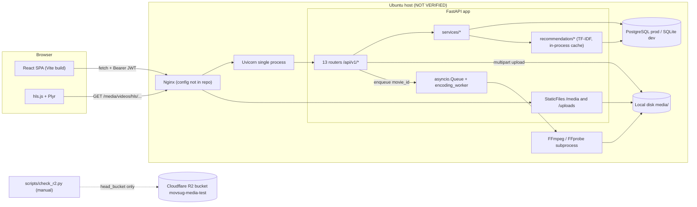

# MovSug — Current Architecture (Evidence-Based Inventory)

| Field | Value |
|---|---|
| Audit date | 2026-10-25 |
| Branch | `main` |
| Commit | `d276c547bf4756811165641fa0a63320da9b6f19` ("feat: add script to verify Cloudflare R2 storage connection") |
| Working tree | Clean before and after the audit (`git status --short` empty) |
| Scope | Entire tracked repository (≈230 tracked files), local `.env` key names only (values never read/printed) |
| Method | Static reading, read-only commands, isolated local test execution |

> [!NOTE]
> Everything below is derived from the repository at the commit above. Production
> infrastructure (Ubuntu server, Nginx, Cloudflare Tunnel, PostgreSQL, R2 bucket) was
> **not** accessed. Statements about production are marked **NOT VERIFIED**.

---

## 1. Repository layout

```
movie-recommendation-system/
├── PROJECT_RULES.md          # team coding rules (tests required, thin routers, no secrets)
├── README.md
├── .gitignore                # ignores .env*, *.db, media/, uploads/, .agents/
├── backend/                  # FastAPI application
│   ├── app/
│   │   ├── main.py           # entry point, lifespan worker, static mounts, CORS
│   │   ├── database.py       # engine + SessionLocal + get_db
│   │   ├── core/             # security.py (JWT/bcrypt), password_validator.py
│   │   ├── models/           # 7 SQLAlchemy models
│   │   ├── schemas/          # Pydantic v2 schemas
│   │   ├── routers/          # 13 routers, all under /api/v1
│   │   ├── services/         # business logic + recommendation/ package
│   │   ├── templates/        # Jinja2 email templates
│   │   ├── scripts/promote_admin.py
│   │   └── seed.py
│   ├── alembic/ + alembic.ini  # 5 linear migrations (head e5f3a1b2c7d8)
│   ├── scripts/
│   │   ├── check_r2.py       # ONLY Cloudflare R2 code in the repo
│   │   ├── migrate_sqlite_to_pg.py
│   │   └── importers/        # MovieLens, Wikidata, Wikimedia, LoC, stock assets
│   ├── tests/                # 14 pytest modules (210 tests)
│   └── requirements.txt      # 14 UNPINNED packages, no boto3
├── frontend/                 # React 19 + TypeScript + Vite 8
│   ├── src/{pages,components,services,hooks,i18n,theme,utils,models,test}
│   ├── package.json / package-lock.json
│   └── .env.production       # tracked; contains only VITE_API_BASE_URL (no secret)
└── docs/                     # prior audits, feature docs, deployment, streaming
```

**Not present in the repository** (verified by `git ls-files`):

| Item | Status |
|---|---|
| `.github/workflows/` (CI/CD) | Absent |
| Dockerfile / docker-compose | Absent |
| Nginx config file | Absent (only a snippet inside [deployment.md](file:///d:/TLTN/movie-recommendation-system/docs/deployment.md#L11-L82)) |
| systemd unit file | Absent (snippet only in [deployment.md](file:///d:/TLTN/movie-recommendation-system/docs/deployment.md#L104-L123)) |
| Cloudflare Tunnel config (`cloudflared`) | Absent |
| Shared libraries / monorepo packages | Absent |
| Playwright / k6 / ZAP / Allure configs | Absent |
| Recommendation evaluation scripts | Absent |

---

## 2. Runtime and framework versions

Versions below are what is **installed locally** (`backend/.venv`, `frontend/package-lock.json`). Because `requirements.txt` is unpinned, production versions are **NOT VERIFIED** and may differ.

| Layer | Component | Version (local) |
|---|---|---|
| Python | CPython | 3.14.3 |
| API | FastAPI / Starlette / Uvicorn | 0.139.0 / 1.3.1 / 0.51.0 |
| ORM / migrations | SQLAlchemy / Alembic | 2.0.51 / 1.18.5 |
| Validation | Pydantic | 2.13.4 |
| Auth | python-jose / bcrypt | 3.5.0 / 5.0.0 |
| ML | scikit-learn / numpy / scipy | 1.9.0 / 2.5.1 / 1.18.0 |
| DB driver | psycopg2-binary | 2.9.12 |
| Test | pytest / httpx | 9.1.1 / 0.28.1 |
| Node | node / npm | 24.14.0 / 11.9.0 |
| UI | React / react-router-dom | 19.2.4 / 7.18.1 |
| Build | Vite / TypeScript | 8.1.4 / 5.9.3 |
| Player | hls.js / Plyr | 1.6.15 / 3.8.4 |
| i18n | i18next | 26.3.6 |
| Frontend test | Vitest + jsdom + Testing Library | 4.1.1 |
| Media | FFmpeg (local dev machine) | present at `C:\ffmpeg\bin\ffmpeg.exe` (version not queried) |

Local virtual environments:

| venv | Status |
|---|---|
| `backend/.venv` | Complete — all runtime + test deps present (used for the test run) |
| `backend/venv` | Missing `jinja2` → 7 test modules fail to import |
| `.venv` (root) | Missing `jinja2`, `numpy`, `scipy`, `sklearn` |
| any | `boto3` **not installed anywhere** |

---

## 3. Logical architecture (as implemented)



Key point: **R2 is not connected to the application at all.** The only link is a manually executed connectivity script.

---

## 4. Backend inventory

### 4.1 Entry point — [main.py](file:///d:/TLTN/movie-recommendation-system/backend/app/main.py)

| Concern | Implementation | Lines |
|---|---|---|
| Env loading | `load_dotenv()` before imports | L9-10 |
| Background worker | `lifespan` starts `encoding_worker()` as an asyncio task | L39-60 |
| Static files | `/uploads` and `/media` served by `StaticFiles` (entire `media/` tree, including source videos) | L66-76 |
| CORS | origins from `CORS_ORIGINS`, credentials allowed, explicit methods/headers | L81-90 |
| Routers | 13 routers included | L93-105 |
| Health check | Only `GET /` returning a welcome message — no DB/FFmpeg/disk health | L107-109 |
| Logging config | None at app level (relies on Uvicorn defaults) | — |
| Schema creation | Explicitly delegated to Alembic (good) | L34-36 |

### 4.2 Routers and endpoints

| Router file | Prefix | Endpoints | Auth |
|---|---|---|---|
| [auth.py](file:///d:/TLTN/movie-recommendation-system/backend/app/routers/auth.py) | `/api/v1/auth` | register, login, forgot-password, reset-password, refresh, me, change-password-request, change-password-confirm | mixed |
| [movies.py](file:///d:/TLTN/movie-recommendation-system/backend/app/routers/movies.py) | `/api/v1/movies` | list, detail, create, update, delete, poster, backdrop, video, process-hls, status, cancel-encode | admin for writes; list/detail/status public |
| [movie_assets.py](file:///d:/TLTN/movie-recommendation-system/backend/app/routers/movie_assets.py) | `/api/v1/movies/{id}/assets` | list, create, delete | admin for writes |
| [favorites.py](file:///d:/TLTN/movie-recommendation-system/backend/app/routers/favorites.py) | `/api/v1/favorites` | me, me/ids, me/merge, add, remove | user |
| [history.py](file:///d:/TLTN/movie-recommendation-system/backend/app/routers/history.py) | `/api/v1/history` | me, record, get | user |
| [watch_progress.py](file:///d:/TLTN/movie-recommendation-system/backend/app/routers/watch_progress.py) | `/api/v1/watch-progress` | save, get | user |
| [ratings.py](file:///d:/TLTN/movie-recommendation-system/backend/app/routers/ratings.py) | `/api/v1/ratings` | upsert, me, movie/me | user |
| [recommendations.py](file:///d:/TLTN/movie-recommendation-system/backend/app/routers/recommendations.py) | `/api/v1/recommendations` | me | user |
| [admin_recommendations.py](file:///d:/TLTN/movie-recommendation-system/backend/app/routers/admin_recommendations.py) | `/api/v1/admin/recommendations` | explain/{user_id} | admin |
| [admin_users.py](file:///d:/TLTN/movie-recommendation-system/backend/app/routers/admin_users.py) | `/api/v1/admin/users` | list, security-audit, role, force-reset-password | admin |
| [admin_dashboard.py](file:///d:/TLTN/movie-recommendation-system/backend/app/routers/admin_dashboard.py) | `/api/v1/admin/dashboard` | metrics | admin |
| [admin_logs.py](file:///d:/TLTN/movie-recommendation-system/backend/app/routers/admin_logs.py) | `/api/v1/admin/logs` | list | admin |
| [users.py](file:///d:/TLTN/movie-recommendation-system/backend/app/routers/users.py) | `/api/v1/users` | me/avatar | user |

**No upload-session, presign, or R2 endpoints exist.**

### 4.3 Service layer

| Service | Responsibility |
|---|---|
| `movie_service.py` | CRUD, filtering, invalidates recommendation cache on create/update/delete |
| `movie_asset_service.py` | Poster/backdrop/video upload orchestration (local disk) |
| `file_storage_service.py` | MIME/size validation, writes to `media/` |
| `hls_service.py` | In-memory queue, FFprobe/FFmpeg, progress, cancellation |
| `auth_service.py` | Users, login tracking, reset tokens, guest-history merge |
| `mail_service.py` | Gmail SMTP (SSL) in background threads; console fallback |
| `recommendation/` | `movie_profile`, `vectorizer`, `user_profile`, `engine`, `explainer`, `explainer_admin` |
| `history_service.py`, `rating_service.py`, `favorite_service.py` | Interaction persistence |
| `admin_service.py` | Audit log writes, last-admin guard |
| `asset_license_service.py`, `license_checker.py` | Per-asset licence tracking |
| `avatar_service.py` | Avatar upload (duplicates file validation logic) |

### 4.4 Data layer

7 tables (see [FEATURE_STATUS_MATRIX.md](FEATURE_STATUS_MATRIX.md) §Database): `users`, `movies`, `ratings`, `user_favorites`, `watch_history`, `movie_assets`, `admin_audit_logs`. Alembic head: `e5f3a1b2c7d8` (matches local SQLite `alembic_version`).

---

## 5. Frontend inventory

| Area | Files |
|---|---|
| Routing | [App.tsx](file:///d:/TLTN/movie-recommendation-system/frontend/src/App.tsx#L34-L53) — 16 routes; admin routes wrapped by `ProtectedAdminRoute` |
| API base | [config.ts](file:///d:/TLTN/movie-recommendation-system/frontend/src/config.ts#L12-L13) — `VITE_API_BASE_URL`, fallback `http://localhost:8000/api/v1` |
| Services | `authService`, `movieService`, `favoriteService`, `ratingService`, `recommendationService`, `recsysService`, `adminService`, `continueWatchingService` |
| Auth state | `hooks/useAuth*.ts(x)`, JWT in `localStorage` ([authService.ts](file:///d:/TLTN/movie-recommendation-system/frontend/src/services/authService.ts#L33-L43)), sliding refresh hook |
| Admin | `AdminMoviesPage`, `components/admin/MovieForm.tsx` (657 lines), `MovieTable.tsx`, `RecsysMonitorPage`, `AdminSecurityAuditPage` |
| Player | [HlsPlayer.tsx](file:///d:/TLTN/movie-recommendation-system/frontend/src/components/HlsPlayer.tsx) — hls.js + Plyr with quality menu |
| i18n | `en` + `vi` namespaces: admin, auth, common, movies, recommendation |
| Tests | 17 Vitest files, 323 tests |

---

## 6. Deployment topology (documented, NOT VERIFIED)

From [deployment.md](file:///d:/TLTN/movie-recommendation-system/docs/deployment.md):

- Nginx terminates TLS (Let's Encrypt), serves `frontend/dist`, proxies `/api/`, `/media/`, `/uploads/` to `127.0.0.1:8000` (L11-82).
- `client_max_body_size 2G` (L81) — but backend allows 5 GB videos ([file_storage_service.py L13](file:///d:/TLTN/movie-recommendation-system/backend/app/services/file_storage_service.py#L13)).
- systemd runs a **single** Uvicorn process bound to localhost (L104-123).
- [streaming_architecture.md L244-252](file:///d:/TLTN/movie-recommendation-system/docs/streaming_architecture.md#L244-L252) claims Nginx serves `/media/` directly via `alias`, contradicting deployment.md which proxies to Uvicorn.
- Prior audit notes state production actually uses a **Cloudflare Tunnel** ([FINAL_PROJECT_AUDIT.md L315](file:///d:/TLTN/movie-recommendation-system/docs/FINAL_PROJECT_AUDIT.md#L315)); no tunnel configuration is versioned.

---

## 7. Known limitations of this inventory

- Production configuration, database contents, and the R2 bucket state could not be inspected.
- Frontend components were sampled, not exhaustively traced for dead code.
- FFmpeg behaviour was analysed statically; no encode was executed.
