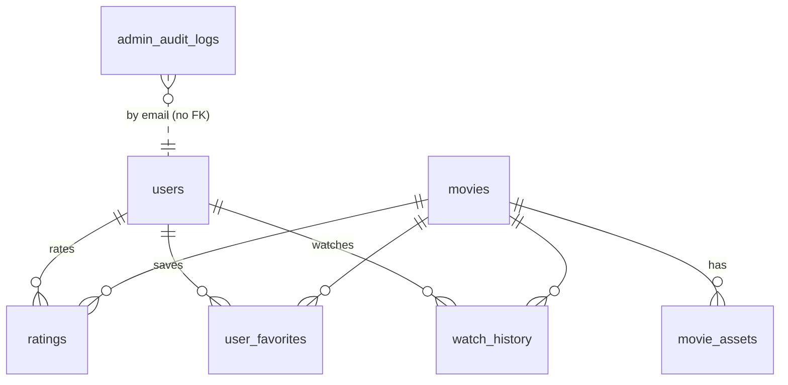

# MovSug — Feature Status Matrix & Gap Analysis

| Field | Value |
|---|---|
| Audit date | 2026-10-25 |
| Commit | `d276c547bf4756811165641fa0a63320da9b6f19` |
| Legend | **IV** implemented & verified by executed tests · **IT** implemented, not tested · **PI** partial · **NI** not implemented · **UV** unable to verify · **BC** blocked by configuration |

---

## 1. Platform features

| Area | Feature | Status | Evidence |
|---|---|---|---|
| Auth | Register / login / JWT / `me` | IV | `test_auth.py` |
| Auth | Sliding refresh | IT (backend) / IV (frontend hook partially) | [auth.py L295-307](file:///d:/TLTN/movie-recommendation-system/backend/app/routers/auth.py#L295-L307) |
| Auth | Forgot / reset password (email) | IV (mocked SMTP) | `test_auth.py`, `test_password_reset_email.py` |
| Auth | Email-confirmed password change | IV (mocked) | `test_user_profile.py` |
| Auth | Account status enforcement | NI | S3 in security audit |
| Auth | Rate limiting | NI | S2 |
| Users | Avatar upload | IV (service mocked in router test) | `test_user_profile.py` |
| Admin | Role change, force reset, security audit, audit logs, dashboard | IT (no dedicated tests found for admin routers) | `routers/admin_*.py` |
| Catalog | Movie CRUD + search/filter/sort | IV | `test_movies.py` |
| Catalog | Vietnamese display metadata | IV | `test_movies.py`, `test_recommendation_invariance.py` |
| Catalog | Licence / source tracking, movie assets | IV | `test_movie_assets.py` |
| Interactions | Favorites (+ guest merge) | IV | `test_favorites.py`, `guestFavorites.test.ts` |
| Interactions | Ratings 1–5 | IT (no dedicated ratings router test found) | `routers/ratings.py` |
| Interactions | Watch progress / continue watching | IV | `test_watch_progress.py`, `continueWatchingService.test.ts` |
| Media | Local poster/backdrop upload | IV | `test_movies.py` |
| Media | Local video upload with progress | IV (backend) / IT (frontend upload UI) | `test_movies.py`; `MovieForm.tsx` untested |
| Media | Upload cancellation (UI) | PI | abort handler unreachable |
| Media | HLS multi-quality encode | IT for FFmpeg behaviour (mocked); IV for state transitions | `test_hls_cache_invalidation.py` |
| Media | Encode queue persistence / restart recovery | NI | H1 |
| Media | HLS playback + quality switching | IT (no `HlsPlayer` test) | [HlsPlayer.tsx](file:///d:/TLTN/movie-recommendation-system/frontend/src/components/HlsPlayer.tsx) |
| Cloud | R2 connectivity check script | IT — owner evidence only, BC locally | [check_r2.py](file:///d:/TLTN/movie-recommendation-system/backend/scripts/check_r2.py) |
| Cloud | R2 direct upload / presign / completion | NI | [R2_UPLOAD_GAP_ANALYSIS.md](R2_UPLOAD_GAP_ANALYSIS.md) |
| i18n | English + Vietnamese UI | IV (storage tests) / IT (coverage of all strings) | `i18n/locales/{en,vi}` |
| Theme | Theme switching | IV | `ThemeContext.test.tsx`, `themeStorage.test.ts` |
| Ops | Health check endpoint | NI (only `/` welcome) | [main.py L107-109](file:///d:/TLTN/movie-recommendation-system/backend/app/main.py#L107-L109) |
| Ops | CI/CD | NI | no `.github/` |
| Ops | Structured logging / metrics | NI | — |
| Ops | Backups | NI / UV | not documented |

## 2. Recommendation features

See [RECOMMENDATION_ENGINE_AUDIT.md §3](RECOMMENDATION_ENGINE_AUDIT.md) for the full classification. Summary: TF-IDF, cosine, rating/favorite/watch weighting, candidate filter and caching are **IV**; time decay and admin explainer are **IT**; negative feedback, cold start, seen-item exclusion and explanations are **PI**; MMR, embeddings, hybrid, CF, offline evaluation, all metrics, latency measurement and experiment tracking are **NI**.

---

## 3. Database audit (Phase D)

### 3.1 Entities

| Table | Key constraints | Notes |
|---|---|---|
| `users` | UNIQUE email; index reset token | `status` free-text (`active`/`suspect`), never enforced |
| `movies` | PK UUID; index title | Processing state embedded in row; JSON lists for genres/cast/keywords; **no `created_at`/`updated_at`** |
| `ratings` | UNIQUE(user, movie); CHECK 1–5; CASCADE | has `created_at`, `updated_at` |
| `user_favorites` | UNIQUE(user, movie); CASCADE | `created_at` |
| `watch_history` | UNIQUE(user, movie); CASCADE | one row per pair → last-state table, not an event log |
| `movie_assets` | FK CASCADE; index (movie, type) | licence metadata; `url`/`local_path` only, no size/checksum/status |
| `admin_audit_logs` | indexes on email, action, created_at | references admin by email string, not FK |

Missing entities: upload sessions, processing jobs, recommendation impressions/clicks, recommendation runs/experiments, user preferences (onboarding), negative feedback ("not interested").

### 3.2 Requirement support

| # | Requirement | Supported | Missing fields / constraints |
|---|---|---|---|
| 1 | Direct R2 upload sessions | No | `upload_sessions` table |
| 2 | Upload completion verification | No | `expected_size`, `actual_size`, `etag`, `content_type`, `completed_at` |
| 3 | Unique R2 object keys | No | `object_key UNIQUE` |
| 4 | Upload ownership | No | `created_by_user_id` FK |
| 5 | Idempotent completion | No | `status` state machine + guarded transition |
| 6 | Video processing jobs | Partial | `processing_jobs` (attempts, started/finished, worker id, error) or at least `processing_started_at` on movies |
| 7 | Recovery from failed uploads | No | `expires_at`, `failed_reason`, cleanup job |
| 8 | Recommendation experiment tracking | No | `rec_runs` (algorithm, config hash, commit) + `rec_impressions` (user, movie, rank, score, run_id, ts) |

Schema notes: `video_source_path`/`hls_playlist_path` are `String(255)` — R2 keys with long filenames can exceed this; migration `87079e588ea0` drops PostgreSQL-named FK constraints (PG-specific). No migrations were run during the audit.

---

## 4. Gap analysis against target capabilities (Phase K)

Complexity: S ≤ 2 days · M 3–5 days · L 1–2 weeks (single developer).

### 4.1 Recommendation improvements (70 % priority)

| Capability | Current Status | Evidence | Missing Work | Priority | Est. Complexity | Dependencies |
|---|---|---|---|---|---|---|
| Reproducible TF-IDF baseline | PI — code exists & tested; not frozen, deps unpinned, logic duplicated | vectorizer.py, user_profile.py, engine.py; requirements.txt | Tag baseline, pin deps, config file, extract pure scoring function shared by API/admin/harness | Must | S-M | none |
| Recommendation evaluation dataset | NI | local DB: 5 users / 2 ratings; MovieLens importer skips ratings | Offline MovieLens loader (separate DB), temporal split, stored split files | Must | M | baseline freeze |
| Offline evaluation metrics | NI | no metric code | P/R/NDCG/HitRate@K, Coverage, ILD, Novelty, latency; per-user results + CI | Must | M | dataset |
| Reproducible experiment reports | NI | — | JSON + Markdown report with commit/config/dataset hash | Must | S | metrics |
| Negative feedback | PI (ignore-only, leak R2) | user_profile.py L152-175 | Explicit-over-implicit precedence; negative weighting; tests | Must | S-M | baseline measured first |
| Seen-item exclusion (enabler) | PI (favorites only) | engine.py L59-62 | Exclude rated/watched per policy | Must | S | baseline measured first |
| Cold-start personalization | PI | engine.py L105-131 | Popularity prior, genre onboarding (optional), correct label, NULL-safe ordering | Should | M | metrics |
| Diversity-aware reranking (MMR) | NI | — | MMR over TF-IDF similarities, λ sweep | Should | S | metrics |
| Explainable recommendations | PI | explainer.py, explainer_admin.py L110-122 | Item-level, grounded overlap + top contributing items; unify admin/user pipeline | Should | M | pure scoring function |
| Semantic embeddings | NI | — | Model choice, offline precompute, storage, scoring | Should / Research | M-L | metrics, infra RAM/CPU check |
| Hybrid recommendation | NI | — | Score normalisation + weighted blend, weight tuning on validation split | Should / Research | M | embeddings |

### 4.2 Infrastructure improvements (30 % priority)

| Capability | Current Status | Evidence | Missing Work | Priority | Est. Complexity | Dependencies |
|---|---|---|---|---|---|---|
| Cloudflare R2 direct upload | NI (connectivity script only) | check_r2.py | Storage service, endpoints, frontend PUT | Must | M | R2 env + boto3 + CORS |
| Presigned PUT URLs | NI | repo search | `generate_presigned_url('put_object')`, expiry, content-type binding | Must | S | storage service |
| Secure upload completion | NI | — | HeadObject verification, ownership, idempotency | Must | S-M | upload_sessions |
| PostgreSQL synchronization | NI | movie.py | Migration: `upload_sessions` + `movies.source_storage/source_object_key` | Must | S-M | schema review |
| R2 integration with FFmpeg | NI | hls_service.py L418-424 | Source resolver: download to temp, cleanup | Must | S-M | completion |
| HLS compatibility | IV (local) | hls_service.py | Keep output local; fix H1/H2 (stuck job, cancel→ready) | Should | S | — |
| Automated functional testing | PI — 533 unit tests, no CI, no coverage, no E2E | test results | GitHub Actions, coverage, isolated test config, Playwright smoke | Must (CI) / Should (E2E) | M | — |
| Load testing | NI | — | k6 scripts for catalog, recommendations, HLS segment fetch (staging) | Should | M | staging env |
| Security testing | NI (manual static only) | this audit | pip-audit, npm audit, bandit in CI; ZAP baseline on staging; fix S1–S5 | Should | M | CI |
| Consolidated test reports | NI | — | Test Center aggregator | Should | M | all tiers |
