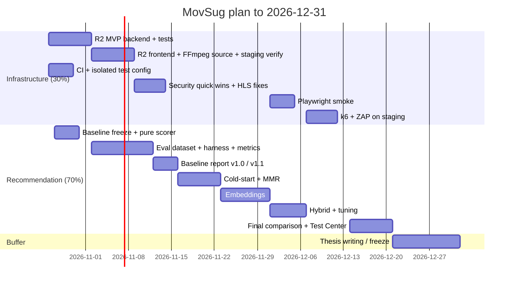

# MovSug — Implementation Roadmap (Proposal for Review)

| Field | Value |
|---|---|
| Prepared | 2026-10-25 (Sunday) |
| Deadline | 2026-12-31 (≈ 9.5 weeks) |
| Based on commit | `d276c547bf4756811165641fa0a63320da9b6f19` |
| Weighting | Recommendation 70 % · Infrastructure 30 % (R2 first, as inherited from the previous weekly report) |
| Status | **Proposal only — no implementation has started. Requires review/approval.** |

> [!IMPORTANT]
> Principle: do not rewrite working components. FFmpeg/HLS, the player, auth, catalog and the TF-IDF engine stay; changes are additive, behind config flags, and each ships with tests (per `PROJECT_RULES.md`).

---

## 1. Prioritisation

### Must-have (thesis cannot be defended without these)

1. R2 direct upload MVP: presigned PUT → completion verification → DB sync → FFmpeg reads R2 source.
2. Reproducible TF-IDF baseline (frozen config, pinned deps, shared pure scoring function).
3. Offline evaluation harness + dataset + metrics (P/R/NDCG@K, Coverage, ILD, latency) + reproducible reports.
4. Fix seen-item exclusion (R1) and negative-feedback leak (R2), measured as `v1.1` vs `v1.0`.
5. CI running existing 533 tests + isolated test config (temp media dir, SMTP disabled).
6. Security quick wins: stop public source-video exposure (S1), enforce token type (S4), enforce account status (S3), hide `processing_error` publicly (S6), basic rate limiting on auth (S2).
7. Fix HLS stuck-job deadlock (H1) and cancel→ready (H2).

### Should-have (strengthens the thesis significantly)

8. Cold-start improvement (popularity prior; optional genre onboarding).
9. MMR diversity re-ranking with λ sweep.
10. Grounded item-level explanations; unify admin explainer with engine.
11. Playwright E2E smoke (login → browse → play → rate → recommendations).
12. k6 load test on staging (catalog, recommendations, HLS segments).
13. ZAP baseline (passive) on staging + pip-audit/npm audit in CI.
14. Consolidated Test Center report.

### Optional research work

15. Semantic embeddings (multilingual sentence model, precomputed).
16. Hybrid TF-IDF + embeddings (+ popularity) with tuned weights.
17. R2 multipart upload (>5 GiB), HLS output on R2/CDN, persistent job queue.
18. Recommendation impression logging for online metrics.

---

## 2. Timeline

| Week | Dates | Infrastructure | Recommendation | Exit criteria |
|---|---|---|---|---|
| 1 | Oct 26 – Nov 1 | R2 storage service, `upload_sessions` model + migration (reviewed), presign + complete endpoints, Stubber tests; CI workflow | Tag `rec-baseline-v1`, pin deps, config file, extract pure scoring function (behaviour-preserving, existing tests green) | CI green; endpoints tested with mocked R2 |
| 2 | Nov 2 – 8 | Frontend direct PUT with progress/abort; bucket CORS (owner); FFmpeg source resolver; staging E2E upload of a small file | MovieLens offline loader, temporal split, metrics module with unit tests on toy data | One real file R2 → HLS on staging |
| 3 | Nov 9 – 15 | Security quick wins S1/S3/S4/S6, HLS H1/H2 | Harness end-to-end; **baseline report v1.0**; implement R1/R2 fixes → **v1.1 report** | Reproducible reports committed |
| 4 | Nov 16 – 22 | Rate limiting (S2) | Cold-start popularity prior; MMR + λ sweep | Comparison table v1.1 vs +cold-start vs +MMR |
| 5–6 | Nov 23 – Dec 6 | Playwright smoke (Dec 1-4) | Embeddings (offline precompute) then hybrid blend + tuning on validation split | Embedding/hybrid metrics on identical splits |
| 7 | Dec 7 – 13 | k6 + ZAP baseline on staging | Grounded explanations; latency benchmark | Load/security reports |
| 8 | Dec 14 – 20 | Test Center aggregation | Final experimental comparison + significance tests | Final report draft |
| 9–10 | Dec 21 – 31 | Freeze, bug fixes only | Thesis chapters, figures | Tagged release |

---

## 3. Next seven days (Oct 26 – Nov 1) — concrete task list

| # | Task | Output | Est. |
|---|---|---|---|
| 1 | Approve this audit and the R2 design in [R2_UPLOAD_GAP_ANALYSIS.md §7](R2_UPLOAD_GAP_ANALYSIS.md) | decisions recorded | 0.5 d |
| 2 | Add R2 variables to `.env.example` (names only), add pinned `boto3` to requirements | config PR | 0.25 d |
| 3 | Owner: create a bucket-scoped R2 API token (object read/write), configure bucket CORS for frontend origins | dashboard change | 0.25 d |
| 4 | `services/storage/r2_client.py` (presign PUT, head, download) + Stubber tests | code + tests | 1 d |
| 5 | `UploadSession` model + Alembic migration (review before applying) + `movies.source_storage/source_object_key` | migration PR | 1 d |
| 6 | `POST /admin/movies/{id}/uploads` and `POST /uploads/{id}/complete` (admin, idempotent, HeadObject verify) + tests | endpoints | 1.5 d |
| 7 | `.github/workflows/ci.yml`: pytest (backend/.venv deps), vitest, eslint; `conftest.py` forcing temp `MEDIA_ROOT` and empty `SMTP_PASSWORD` | CI | 0.75 d |
| 8 | Tag `rec-baseline-v1`; `recommendation/config.py` holding current constants; extract pure scorer used by engine + admin explainer (existing 31 recommendation-related tests must pass unchanged) | baseline freeze | 1 d |
| 9 | Download MovieLens `ml-latest-small` locally (not committed), write dataset README with checksum | dataset | 0.25 d |

---

## 4. Sequencing rationale

1. **R2 first** — inherited commitment and unblocks large uploads that Cloudflare's proxy body limit likely prevents today (verify).
2. **CI next to R2** — every subsequent change is protected by the 533 existing tests.
3. **Freeze baseline before fixing R1/R2** — otherwise the original behaviour can never be measured.
4. **Metrics before new algorithms** — cold-start/MMR/embeddings are worthless for the thesis without comparable numbers.
5. **Embeddings/hybrid last** among algorithm work — heaviest dependency (torch), highest risk; the thesis remains complete without them.
6. **Load/security testing on staging only** and late, once features stabilise.

---

## 5. Risks to the plan

| Risk | Mitigation |
|---|---|
| R2 CORS / token misconfiguration delays week 2 | Keep local upload path as fallback; verify with a tiny file first |
| MovieLens has no plot text → TF-IDF signal weak | State clearly; use genres + tags; optional TMDB enrichment as extension |
| Embedding model too heavy for production host | Precompute offline; serve vectors only; evaluate offline even if not deployed |
| Production DB/infra unknown | Owner to provide: Uvicorn worker count, Nginx config, Cloudflare plan, PG version, data volume |
| Python 3.14 + unpinned deps break builds | Pin versions; record exact interpreter in reports |
