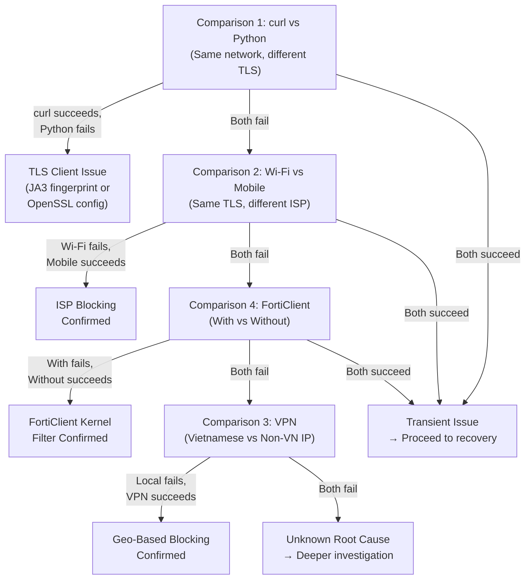

# Phase 8D.2 — Network Comparison Plan (Kế hoạch so sánh mạng)

**Date**: 2026-11-10  
**Phase**: Phase 8D.2 — TLS Connectivity Diagnosis and Safe Pilot Recovery  
**Purpose**: Systematic plan to isolate the TLS failure to a specific network component

---

## 1. Mục tiêu / Objective

Determine whether the TLS handshake failure to `api.themoviedb.org` is caused by:

- **(A)** The local TLS implementation (OpenSSL vs Schannel)
- **(B)** The network path (ISP, DPI, intermediate equipment)
- **(C)** The remote server (CloudFront edge configuration)
- **(D)** A local software filter (FortiClient kernel driver)

Each comparison changes exactly one variable while holding others constant.

---

## 2. Ma trận so sánh / Comparison Matrix

### 2.1 Comparison 1: Schannel vs OpenSSL (Same Network)

| Variable | Probe A (curl) | Probe B (Python) |
|----------|----------------|-----------------|
| TLS implementation | Schannel | OpenSSL 3.0.18 |
| Certificate store | Windows Store | certifi bundle |
| Network path | Same Wi-Fi | Same Wi-Fi |
| Target | `api.themoviedb.org:443` | `api.themoviedb.org:443` |

**What this tests**: Whether the TLS client implementation matters

**Interpretation**:
- A succeeds, B fails → **TLS client fingerprint or OpenSSL configuration issue**
- Both fail → Network path issue (proceed to Comparison 2)
- Both succeed → Transient issue resolved (proceed to recovery authorization)

### 2.2 Comparison 2: Same ISP vs Different ISP (Same TLS Stack)

| Variable | Test 1 (Wi-Fi) | Test 2 (Mobile Hotspot) |
|----------|----------------|------------------------|
| TLS implementation | OpenSSL 3.0.18 | OpenSSL 3.0.18 |
| Network path | Current Wi-Fi ISP | Mobile carrier ISP |
| Target | `api.themoviedb.org:443` | `api.themoviedb.org:443` |

**What this tests**: Whether the ISP is the blocking entity

**Interpretation**:
- Wi-Fi fails, Mobile succeeds → **ISP-level blocking confirmed**
- Both fail → Not ISP-specific (proceed to Comparison 3)
- Both succeed → Transient issue (proceed to recovery)

### 2.3 Comparison 3: Vietnamese IP vs Non-Vietnamese IP

| Variable | Test 1 (Local) | Test 2 (VPN) |
|----------|----------------|--------------|
| TLS implementation | OpenSSL 3.0.18 | OpenSSL 3.0.18 |
| Source IP | Vietnamese (42.116.x.x) | Non-Vietnamese (via VPN) |
| Target | `api.themoviedb.org:443` | `api.themoviedb.org:443` |

**What this tests**: Whether CloudFront blocks by source IP geolocation

> [!WARNING]
> VPN routing TMDB credentials through an authorized VPN is acceptable for
> diagnostic purposes. Do NOT route credentials through arbitrary third-party
> proxies or untrusted VPN services.

**Interpretation**:
- Local fails, VPN succeeds → **Geo-based or ISP-based blocking confirmed**
- Both fail → Client-side issue (FortiClient kernel driver or system config)
- Both succeed → Transient issue (proceed to recovery)

### 2.4 Comparison 4: With FortiClient vs Without FortiClient

| Variable | Test 1 (Current) | Test 2 (FortiClient Disabled) |
|----------|-------------------|-------------------------------|
| TLS implementation | OpenSSL 3.0.18 | OpenSSL 3.0.18 |
| FortiClient | Running | Stopped / Disabled |
| Network path | Same Wi-Fi | Same Wi-Fi |

> [!IMPORTANT]
> Stopping FortiClient services may require administrator privileges and could
> affect enterprise security policies. Only perform this with IT authorization
> if the machine is enterprise-managed.

**Interpretation**:
- With FortiClient fails, Without succeeds → **FortiClient kernel filter confirmed**
- Both fail → FortiClient is not the cause
- Both succeed → Transient issue

---

## 3. Thứ tự thực hiện / Recommended Execution Order



### 3.1 Rationale for Order

1. **Comparison 1 first**: Cheapest to execute (no network changes needed), and
   distinguishes a client-side TLS issue from a network issue. Uses only the
   probe commands in `PHASE8D2_SAFE_PROBE_COMMANDS.md`.

2. **Comparison 2 second**: If both TLS stacks fail, test a different network
   path. Mobile hotspot is readily available and changes the ISP.

3. **Comparison 4 third**: If multiple ISPs fail, test FortiClient removal.
   This is more invasive (requires admin privileges) so it's lower priority.

4. **Comparison 3 last**: VPN testing is the most complex and may introduce
   new variables (VPN software, routing changes). Only needed if all local
   tests fail.

---

## 4. Các điều kiện dừng / Stop Conditions

### 4.1 When to Stop Diagnosing

Stop the comparison matrix when:

1. **One comparison clearly identifies the blocking entity** — Document the
   finding and update the recovery plan.

2. **Both probes succeed on the current network** — The issue may have been
   transient. Proceed to a single unauthenticated HTTP connectivity check
   before considering a new pilot.

3. **All comparisons exhausted** — Document all results and escalate as an
   unresolved network issue.

### 4.2 What NOT to Do During Comparison

- Do NOT make authenticated TMDB API requests
- Do NOT use TMDB API tokens in probe commands
- Do NOT reset the previous pilot budget or checkpoint
- Do NOT modify Windows firewall rules
- Do NOT disable certificate verification
- Do NOT route credentials through untrusted proxies
- Do NOT change DNS resolver to untrusted servers

---

## 5. Ghi chép kết quả / Result Recording Template

For each comparison executed, record:

```markdown
### Comparison N: [Description]

**Date/Time**: YYYY-MM-DD HH:MM (UTC+7)
**Network**: [Wi-Fi / Mobile Hotspot / VPN]
**ISP**: [Provider name and IP range]
**FortiClient**: [Running / Stopped / Uninstalled]

| Probe | TLS Stack | Result | Detail |
|-------|-----------|--------|--------|
| A (curl) | Schannel | [OK/FAIL] | [TLS version or error] |
| B (Python) | OpenSSL | [OK/FAIL] | [TLS version or error] |

**Conclusion**: [What this comparison proves or eliminates]
```

---

## 6. References / Tài liệu tham chiếu

| Document | Path |
|----------|------|
| TLS connectivity diagnosis | `docs/audit/PHASE8D2_TLS_CONNECTIVITY_DIAGNOSIS.md` |
| Safe probe commands | `docs/audit/PHASE8D2_SAFE_PROBE_COMMANDS.md` |
| Recovery readiness | `docs/audit/PHASE8D2_RECOVERY_READINESS.md` |
| Phase 8D.1 root cause analysis | `docs/audit/PHASE8D_TLS_ROOT_CAUSE_ANALYSIS.md` |

