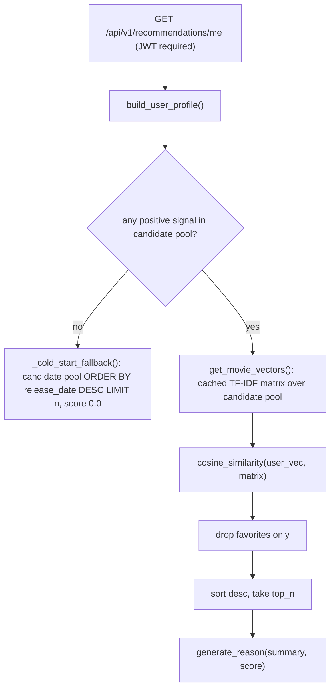

# MovSug — Recommendation Engine Audit (HIGH PRIORITY)

| Field | Value |
|---|---|
| Audit date | 2026-10-25 |
| Commit | `d276c547bf4756811165641fa0a63320da9b6f19` |
| Scope | `backend/app/services/recommendation/*`, related services, routers, tests, importers, local dev DB statistics |
| Verification | Static analysis + 210 backend tests executed (all pass). No offline metric could be computed — no ground truth exists. |

---

## 1. Executive summary

The engine is a **pure content-based recommender**: TF-IDF over a concatenated metadata string, a weighted-average user profile built from ratings / favorites / watch history, and cosine-similarity ranking. It is small, readable, unit-tested and explainable — a good **baseline**.

However, there is **no evaluation infrastructure at all** (no dataset split, no metrics, no experiment tracking), and the audit found several correctness issues that would materially distort any experiment if not addressed or at least documented before measuring the baseline:

| # | Finding | Severity | Evidence |
|---|---|---|---|
| R1 | Only **favorites** are excluded from results; already-rated and already-watched movies can be recommended back (often at the very top because they are part of the profile). | High | [engine.py L59-62](file:///d:/TLTN/movie-recommendation-system/backend/app/services/recommendation/engine.py#L59-L62) |
| R2 | **Negative feedback leaks as positive**: a 1–2★ rating is skipped (weight 0), but if the same movie is in watch history, its watch weight (≥ ~1.0 × decay) is still applied via `max()`. A disliked-but-watched film pulls the profile *towards* itself. | High | [user_profile.py L152-175](file:///d:/TLTN/movie-recommendation-system/backend/app/services/recommendation/user_profile.py#L152-L175) |
| R3 | Cold-start fallback is labelled "Popular movie" but is actually ordered by `release_date DESC`; on PostgreSQL `DESC` puts `NULL` dates **first**, on SQLite **last** → dev/prod behaviour differs. | Medium | [engine.py L105-131](file:///d:/TLTN/movie-recommendation-system/backend/app/services/recommendation/engine.py#L105-L131) |
| R4 | Admin explainer re-implements the pipeline and **diverges**: it does not exclude favorites, so the "explained" top-N differs from what the user sees. | Medium | [explainer_admin.py L274-282](file:///d:/TLTN/movie-recommendation-system/backend/app/services/recommendation/explainer_admin.py#L274-L282) |
| R5 | Admin "contributing factors" are **not grounded**: "Matched genres" lists *all* genres of the candidate, "Matched director" is printed whenever a director exists — no overlap is computed. | Medium (thesis credibility) | [explainer_admin.py L110-122](file:///d:/TLTN/movie-recommendation-system/backend/app/services/recommendation/explainer_admin.py#L110-L122) |
| R6 | User-facing explanations are **list-level, not item-level**: the reason is derived only from interaction counts + score bucket. | Low | [explainer.py L9-46](file:///d:/TLTN/movie-recommendation-system/backend/app/services/recommendation/explainer.py#L9-L46) |
| R7 | Cache validity is keyed on **candidate count** only. Mitigated by explicit invalidation on create/update/delete/HLS-ready, but any direct DB edit or same-count swap leaves stale vectors. Per-process cache (not shared across workers). | Low | [vectorizer.py L62-79](file:///d:/TLTN/movie-recommendation-system/backend/app/services/recommendation/vectorizer.py#L62-L79) |
| R8 | Candidate pool treats `video_source_path IS NOT NULL` as "uploaded", so movies whose encode **failed** or is still processing are recommendable but unplayable. | Low-Medium | [vectorizer.py L50-57](file:///d:/TLTN/movie-recommendation-system/backend/app/services/recommendation/vectorizer.py#L50-L57) |
| R9 | Each request runs `db.query(Movie).all()` and a `count()` — fine for 17 movies, O(catalog) per request. | Low | [engine.py L77-78](file:///d:/TLTN/movie-recommendation-system/backend/app/services/recommendation/engine.py#L77-L78) |
| R10 | Local data is far too small for evaluation (5 users, 17 movies, 2 ratings, 2 favorites, 20 watch rows). Production volume **NOT VERIFIED**. | Blocking for evaluation | read-only query on `backend/test.db` |

---

## 2. How the engine works today (exact pipeline)

### 2.1 Movie content profiling — [movie_profile.py](file:///d:/TLTN/movie-recommendation-system/backend/app/services/recommendation/movie_profile.py#L16-L65)

Single string per movie, weights via repetition:

| Field | Weight | Notes |
|---|---|---|
| title | ×2 | raw |
| overview | ×1 | raw English text |
| genres | ×1 | space-joined (multi-word genres split into tokens) |
| cast | ×1 | `"actor <name lower>"` per actor — with unigram+bigram tokenisation this produces tokens like `actor`, `tom`, `hanks`, `tom hanks`, and cross-boundary noise like `hanks actor` |
| keywords | ×2 | lower-cased |
| director | ×1 | `"director <name>"` |

Vietnamese fields (`title_vi`, `overview_vi`, `keyword_labels_vi`) are **intentionally excluded** — verified by [test_recommendation_invariance.py](file:///d:/TLTN/movie-recommendation-system/backend/tests/test_recommendation_invariance.py).

### 2.2 Text normalisation and TF-IDF — [vectorizer.py L101-111](file:///d:/TLTN/movie-recommendation-system/backend/app/services/recommendation/vectorizer.py#L101-L111)

`TfidfVectorizer(max_features=5000, stop_words="english", ngram_range=(1,2), min_df=1, max_df=0.95 if n≥2 else 1.0)`; sklearn default lower-casing and token pattern. No stemming/lemmatisation, no accent handling, no explicit field namespacing (a director surname can collide with an overview word).

The vectorizer is **fit only on the candidate pool** (by default movies with uploaded video). With ~16 documents, IDF values are extremely coarse; this must be stated when reporting results.

### 2.3 User profile — [user_profile.py](file:///d:/TLTN/movie-recommendation-system/backend/app/services/recommendation/user_profile.py#L57-L200)

| Signal | Weight | Lines |
|---|---|---|
| Rating 5 / 4 / 3 | 5.0 / 3.0 / 1.0 | L62-68 |
| Rating 2 / 1 | 0.0 (skipped) | L62-68, L157 |
| Favorite | 3.0 | L57 |
| Watch | `(1 + 2·progress/100) × 1/(1 + 0.05·days)`, capped 3.0 | L77-110 |
| Combination | `max()` across signals per movie (no summing) | L150-175 |
| Aggregation | weighted mean of TF-IDF rows, then L2-normalised | L181-200 |

Only interactions with movies **inside the candidate pool** contribute (`mid in id_to_idx`).

### 2.4 Ranking, filtering, explanation

- Score = cosine(user_vector, movie_vector) ([engine.py L57](file:///d:/TLTN/movie-recommendation-system/backend/app/services/recommendation/engine.py#L57)).
- Exclusion = favorites only (R1).
- No diversity, popularity, recency or business re-ranking.
- `reason` = "Based on your ratings/favorites/…" + "Strong/Good match/You might like this" by score threshold.

### 2.5 Caching and invalidation

| Trigger | Invalidates? | Evidence |
|---|---|---|
| Movie create / update / delete | Yes | [movie_service.py L172, L205, L220](file:///d:/TLTN/movie-recommendation-system/backend/app/services/movie_service.py#L172) |
| HLS conversion becomes ready | Yes | [hls_service.py L483, L521](file:///d:/TLTN/movie-recommendation-system/backend/app/services/hls_service.py#L483) |
| Video uploaded | Indirectly (candidate count changes) | vectorizer.py L71-79 |
| Ratings / favorites / watch | Not needed — user profile is rebuilt per request (no user cache) | user_profile.py |
| Direct DB edits, importers | **No** (count-based check only) | vectorizer.py L71-79 |

---

## 3. Capability classification

Legend: **IV** = implemented & verified by executed tests · **IT** = implemented, not tested · **PI** = partially implemented · **NI** = not implemented · **UV** = unable to verify.

| Capability | Status | Evidence / Notes |
|---|---|---|
| TF-IDF baseline | **IV** | vectorizer.py; `TestEndToEndRecommendation` (5 tests) pass |
| Cosine similarity ranking | **IV** | engine.py L57; tests pass |
| Ratings-based weighting | **IV** | user_profile.py L152-158; `test_basic_rating_recommendation` |
| Favorites-based weighting | **IV** | L160-164; `test_favorite_influences_recommendations` |
| Watch-history weighting | **IV** | L166-175; `test_watch_history_influences_recommendations` |
| Time decay | **IT** | `_watch_weight` L77-110; no test asserts decay values directly (tests cover influence, not decay curve) |
| Candidate filtering (uploaded-only) | **IV** | `test_candidate_filter.py` (7 tests) — but see R8 |
| Exclude already-seen items | **PI** | favorites only (R1) |
| Negative feedback | **PI** (ignore-only, with leak R2) | `TestNegativeSignals` verifies low ratings are *excluded*, not that they *push away*; watched+disliked case untested |
| Cold-start | **PI** | release-date fallback, mislabelled as popular (R3); guest watch history merged at login ([auth_service.py L199-227](file:///d:/TLTN/movie-recommendation-system/backend/app/services/auth_service.py#L199-L227)) helps |
| Cold-start personalisation (onboarding/genre prefs/popularity) | **NI** | — |
| Recommendation explanations | **PI** | generic user-facing reasons; admin factors not grounded (R5) |
| Admin transparency tool | **IT** | explainer_admin.py; no test file references it |
| Caching + invalidation | **IV** | `TestCacheInvalidation` (3), `test_hls_cache_invalidation.py` (5) |
| Diversity-aware re-ranking | **NI** | — |
| MMR | **NI** | repo-wide search: no match |
| Semantic embeddings | **NI** | no sentence-transformers / embedding code |
| Hybrid recommendation | **NI** | — |
| Collaborative filtering | **NI** | — |
| Offline evaluation harness | **NI** | — |
| Precision@K / Recall@K / NDCG@K | **NI** | [REPORT_FACTS_SNAPSHOT.md L421](file:///d:/TLTN/movie-recommendation-system/docs/REPORT_FACTS_SNAPSHOT.md#L421) also states "No evaluation metrics" |
| Coverage@K / Intra-List Diversity | **NI** | — |
| Latency measurement | **NI** | no timing/metrics instrumentation |
| Recommendation logging (impressions/clicks) | **NI** | no table/model |
| Experiment tracking / versioning | **NI** | `algorithm_version` string exists only in admin payload |
| Evaluation dataset with relevance labels | **NI** | see §4 |

---

## 4. Evaluation data assessment

| Source | Usable for offline evaluation? | Why |
|---|---|---|
| Local dev DB (`backend/test.db`) | **No** | 5 users, 17 movies, 2 ratings, 2 favorites, 20 watch rows; 2 users with ≥5 interactions |
| Production DB | **UV** | not accessed; volume unknown |
| `watch_history` schema | Limited | unique `(user_id, movie_id)` → one row per pair, last timestamp only; no event log, no impressions ([watch_history.py L10-12](file:///d:/TLTN/movie-recommendation-system/backend/app/models/watch_history.py#L10-L12)) |
| [import_movielens.py](file:///d:/TLTN/movie-recommendation-system/backend/scripts/importers/import_movielens.py) | Partial | imports movies + genres + tags into the **live** DB; ratings are only **counted, not imported** (L66-73); no overview; imported movies have no video so they are excluded by the default candidate filter |

> [!IMPORTANT]
> Meaningful Precision/Recall/NDCG cannot be computed from the current application data. An **offline** dataset with held-out relevance labels is required (e.g. MovieLens `ml-latest-small`: ~100k ratings, ~9.7k movies, ~600 users, tags, and `links.csv` to TMDB IDs). Relevance can be defined as held-out ratings ≥ 4.0. The evaluation must run against a **separate SQLite/in-memory dataset**, never the production DB.

Content-feature caveat: MovieLens has no plot text. Options: (a) genres + tags only (reproducible, licence-clean for research), (b) enrich with TMDB overviews via `links.csv` (requires TMDB API key + attribution; adds reproducibility burden). Recommend (a) as the primary experiment and (b) as an optional extension.

---

## 5. Preserving TF-IDF as a reproducible baseline

1. **Freeze the reference**: tag commit `d276c54` (or the first commit after test-only refactors) as `rec-baseline-v1`. Record all hyper-parameters (TF-IDF params, `RATING_WEIGHTS`, `WEIGHT_FAVORITE`, `DECAY_RATE`, exclusion policy) in a versioned config file.
2. **Pin dependencies** (`requirements.txt` is unpinned — scikit-learn/numpy changes can alter tokenisation/IDF). Produce a lock file (`pip freeze` or `pip-tools`).
3. **Extract a pure scoring function** (future work, behaviour-preserving): `score(profile_items: dict[id, weight], matrix, ids) -> ranked list` that both the API and the offline harness call. Today, `engine.py` and `explainer_admin.py` each embed the logic (R4).
4. Report **two baselines**: `v1.0-as-is` (current behaviour, including R1/R2) and `v1.1-fixed` (seen-item exclusion + negative feedback). This makes the impact of the bug fixes itself a measurable result.
5. Fix random seeds and split definitions; store split files (user/item IDs) so every variant runs on identical data.

---

## 6. Recommended evaluation protocol (proposal)

| Element | Proposal |
|---|---|
| Dataset | MovieLens `ml-latest-small` (offline), optional TMDB enrichment |
| Split | Per-user temporal: last 20% of each user's ratings (by timestamp) → test; users with ≥ 10 ratings |
| Relevance | test ratings ≥ 4.0 |
| Profile input | train interactions mapped to the existing weights (5★→5.0 etc.) |
| Candidates | all items not in the user's train set |
| K | 5, 10, 20 |
| Accuracy | Precision@K, Recall@K, NDCG@K, HitRate@K, MAP@K |
| Beyond-accuracy | Catalog Coverage@K, Intra-List Diversity (1 − mean pairwise cosine on TF-IDF or genre Jaccard), Novelty (mean −log₂ popularity) |
| Efficiency | profile build + scoring latency p50/p95 over N users; matrix fit time |
| Significance | paired Wilcoxon / bootstrap CI on per-user NDCG@10 |
| Output | JSON + Markdown report per run with commit hash, config hash, dataset checksum |

Variants to compare (in order): `TFIDF-v1.0` → `TFIDF-v1.1 (fixes)` → `+ cold-start popularity prior` → `+ MMR (λ ∈ {0.3,0.5,0.7})` → `Embeddings` → `Hybrid (TF-IDF + Embeddings [+ popularity])`.

---

## 7. Improvement notes per target capability

| Capability | Smallest viable approach | Complexity |
|---|---|---|
| Seen-item exclusion | Exclude rated + completed-watch + favorites (configurable) | S |
| Negative feedback | Explicit rating overrides implicit watch; Rocchio-style `u = Σw⁺v − β·Σw⁻v` with β≈0.5 for ≤2★ | S-M |
| Cold-start | Popularity prior from interaction counts (Bayesian average), optional genre onboarding, keep guest-history merge | M |
| MMR | Re-rank top-50 by `λ·rel − (1−λ)·max_sim(selected)` using the existing TF-IDF matrix | S |
| Item-level explanations | Top contributing profile movies by `w_i · cos(v_i, candidate)`; real genre/keyword overlap sets | M |
| Semantic embeddings | Multilingual sentence model (e.g. `paraphrase-multilingual-MiniLM-L12-v2`), precomputed offline and stored as `.npy`/table; CPU-only inference at fit time | M-L (adds torch dependency) |
| Hybrid | Weighted linear blend of normalised TF-IDF + embedding (+ popularity) scores; weights tuned on validation split | M |
| Latency | `time.perf_counter()` around fit/profile/score + offline benchmark; later Prometheus histogram | S |

---

## 8. Test coverage evidence (executed 2026-10-25)

| Test module | Tests | Covers |
|---|---|---|
| `test_recommendation_engine.py` | 18 | end-to-end ranking, cold start, empty catalog, cache invalidation, low/neutral ratings |
| `test_candidate_filter.py` | 7 | uploaded-only pool, flag on/off, cold start respects filter |
| `test_hls_cache_invalidation.py` | 5 | cache invalidated only on successful encode |
| `test_recommendation_invariance.py` | 1 | Vietnamese metadata excluded from corpus |

Untested: decay curve values, watched+disliked interaction (R2), rated-item exclusion (R1), admin explainer, PostgreSQL NULL ordering (R3), latency.

---

## 9. Known limitations

- No metric values are reported because no ground-truth dataset exists in the repository; any number would be fabricated.
- Production interaction volume was not observed.
- Findings R1–R3 are confirmed by code reading; their user-visible impact on production was not observed at runtime.
