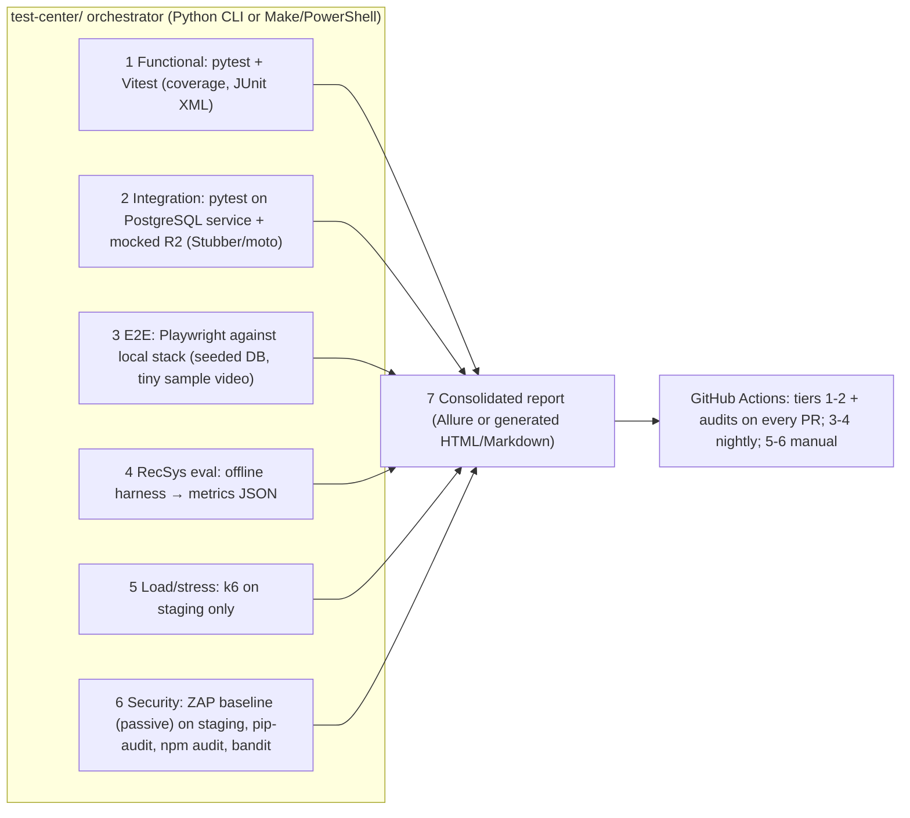

# MovSug — Security & Testing Audit

| Field | Value |
|---|---|
| Audit date | 2026-10-25 |
| Commit | `d276c547bf4756811165641fa0a63320da9b6f19` |
| Method | Static review only. No exploitation, scanning, or load testing was performed against any environment. |
| Classification | **Confirmed** = proven by code reading/test · **Suspected** = likely, depends on config · **Runtime** = requires runtime/production verification |

---

## Part A — Security

### A.1 Prioritised risk register

| ID | Risk | Severity | Class | Evidence | Recommendation |
|---|---|---|---|---|---|
| S1 | **Source videos publicly downloadable.** `/media` mounts the entire media tree (incl. `videos/source`) and public `GET /movies/{id}` returns `video_url` pointing to the original file. Content tagged `non_commercial_only` etc. can be bulk-downloaded. | High | Confirmed (code); production exposure Runtime | [main.py L76](file:///d:/TLTN/movie-recommendation-system/backend/app/main.py#L76), [schemas/movie.py L254-257](file:///d:/TLTN/movie-recommendation-system/backend/app/schemas/movie.py#L254-L257) | Stop exposing `video_url` publicly; do not serve `videos/source` statically (Nginx `deny`); moving sources to a private R2 bucket solves this structurally |
| S2 | **No rate limiting / lockout** on `login`, `register`, `forgot-password`, `change-password-request`. Failed logins only set `status="suspect"`, which is never enforced. | High | Confirmed | [auth.py L220-246](file:///d:/TLTN/movie-recommendation-system/backend/app/routers/auth.py#L220-L246), [auth_service.py L77-89](file:///d:/TLTN/movie-recommendation-system/backend/app/services/auth_service.py#L77-L89); no limiter dependency in repo | Add per-IP/per-account throttling (app-level or Nginx/Cloudflare rules); progressive delay |
| S3 | **Account status not enforced.** Neither `authenticate_user` nor `get_current_user` checks `user.status`; an admin cannot effectively disable an account. | Medium | Confirmed | [auth_service.py L49-60](file:///d:/TLTN/movie-recommendation-system/backend/app/services/auth_service.py#L49-L60), [auth.py L43-78](file:///d:/TLTN/movie-recommendation-system/backend/app/routers/auth.py#L43-L78) | Reject `disabled/banned` at login and in `get_current_user` |
| S4 | **JWT purpose confusion & replay.** Change-password tokens use the same key/alg and are accepted by `get_current_user` (no `typ`/`purpose` check) — an emailed 15-min link token works as a bearer token. The confirm token is reusable within its lifetime (no `jti`), and it embeds the **bcrypt hash of the new password** in a readable payload sent by email. | Medium | Confirmed | [security.py L35-57](file:///d:/TLTN/movie-recommendation-system/backend/app/core/security.py#L35-L57), [auth.py L343-351, L369-397](file:///d:/TLTN/movie-recommendation-system/backend/app/routers/auth.py#L343-L351) | Add `typ` claim and enforce `typ=access` in `get_current_user`; store pending change server-side with single-use nonce |
| S5 | **No session revocation.** Password change/reset does not invalidate existing JWTs (lifetime 8–24 h, sliding refresh); token kept in `localStorage` (XSS-readable). | Medium | Confirmed | [auth.py L295-307](file:///d:/TLTN/movie-recommendation-system/backend/app/routers/auth.py#L295-L307), [authService.ts L33-43](file:///d:/TLTN/movie-recommendation-system/frontend/src/services/authService.ts#L33-L43) | Reject tokens with `iat < last_password_change`; consider shorter access token |
| S6 | **Internal error disclosure.** `processing_error` (raw FFmpeg stderr / Python exception text) is returned by public `GET /movies/{id}` and unauthenticated `GET /movies/{id}/status`. | Medium | Confirmed | [schemas/movie.py L223](file:///d:/TLTN/movie-recommendation-system/backend/app/schemas/movie.py#L223), [movies.py L257-277](file:///d:/TLTN/movie-recommendation-system/backend/app/routers/movies.py#L257-L277), [hls_service.py L547](file:///d:/TLTN/movie-recommendation-system/backend/app/services/hls_service.py#L547) | Admin-only field; public generic message |
| S7 | **Spoofable client IP.** `_extract_client_ip` picks the *leftmost* public IP in `X-Forwarded-For`, which the client controls (Nginx appends). Behind Cloudflare the trustworthy header is `CF-Connecting-IP`. Affects security-audit data integrity only. | Medium | Confirmed logic; impact Runtime | [auth.py L159-193](file:///d:/TLTN/movie-recommendation-system/backend/app/routers/auth.py#L159-L193) | Trust only the proxy-set header / rightmost untrusted hop |
| S8 | **Weak upload content validation.** Video accepted on client-declared `video/*` MIME; extension can fall back to the user's filename (e.g. `video/x` + `a.html` → stored `.html`) and is served same-origin by `StaticFiles`. Images validated by MIME only (no magic bytes). Admin-only, so stored-XSS requires admin compromise. | Medium-Low | Confirmed | [file_storage_service.py L30-37, L90-106](file:///d:/TLTN/movie-recommendation-system/backend/app/services/file_storage_service.py#L30-L37) | Extension allow-list; ffprobe/magic-byte check; `X-Content-Type-Options: nosniff` |
| S9 | Password-reset tokens stored **in plaintext** in DB. | Low-Medium | Confirmed | [auth_service.py L136-137](file:///d:/TLTN/movie-recommendation-system/backend/app/services/auth_service.py#L136-L137) | Store SHA-256 of token |
| S10 | User enumeration via `register` ("Email already registered") and login timing (no dummy bcrypt for unknown users). | Low | Confirmed | [auth.py L202-207](file:///d:/TLTN/movie-recommendation-system/backend/app/routers/auth.py#L202-L207), [auth_service.py L55-57](file:///d:/TLTN/movie-recommendation-system/backend/app/services/auth_service.py#L55-L57) | Accept as known limitation or normalise |
| S11 | `LIKE` wildcard injection in filters (`%`, `_` not escaped). Not SQL injection — ORM binds parameters. | Low | Confirmed | [movie_service.py L52-99](file:///d:/TLTN/movie-recommendation-system/backend/app/services/movie_service.py#L52-L99) | Escape wildcards |
| S12 | `DELETE /movies/{movie_id}/assets/{asset_id}` does not check that the asset belongs to `movie_id` (admin-only). | Low | Confirmed | [asset_license_service.py L121-128](file:///d:/TLTN/movie-recommendation-system/backend/app/services/asset_license_service.py#L121-L128) | Filter by both IDs |
| S13 | Mail console fallback logs the first 500 chars of HTML bodies (may contain reset links) when SMTP is unset; successful sends log recipient emails (PII). | Low | Confirmed | [mail_service.py L150-157, L133](file:///d:/TLTN/movie-recommendation-system/backend/app/services/mail_service.py#L150-L157) | Redact links in logs |
| S14 | Security headers (CSP, HSTS, nosniff, frame-ancestors) not set by app; Nginx config not versioned. | Low-Medium | Runtime | — | Version the Nginx config; add headers |
| S15 | Dependency hygiene: `requirements.txt` unpinned; no `pip-audit`; `python-jose` lightly maintained (pulls `ecdsa`, which has an unfixed timing advisory, irrelevant for HS256). | Low | Confirmed | [requirements.txt](file:///d:/TLTN/movie-recommendation-system/backend/requirements.txt) | Pin + lock; consider PyJWT; add pip-audit in CI |
| S16 | `npm audit`: 15 findings (11 high, 4 moderate), almost all dev/build tooling (vite, vitest, postcss, brace-expansion…). Runtime-relevant: `react-router` advisory concerns **RSC mode** (not used by this SPA → likely N/A). | Low | Confirmed (advisory DB), applicability partly Suspected | `npm audit --json` | `npm audit fix` in a dedicated PR with test run |

### A.2 Controls that are in place (positive evidence)

| Control | Evidence |
|---|---|
| Fatal startup if `SECRET_KEY` missing | [security.py L11-17](file:///d:/TLTN/movie-recommendation-system/backend/app/core/security.py#L11-L17) |
| bcrypt password hashing | [security.py L25-32](file:///d:/TLTN/movie-recommendation-system/backend/app/core/security.py#L25-L32) |
| Password complexity validator (server + client) | `core/password_validator.py`, `utils/passwordValidator.ts` (tested) |
| Admin-only guards on all admin and write endpoints | `get_current_admin_user` usage in movies/admin_* routers |
| Object-level isolation for user data | favorites/ratings/history/watch-progress always filter by `current_user.id` |
| Last-admin demotion guard | [admin_users.py L67-73](file:///d:/TLTN/movie-recommendation-system/backend/app/routers/admin_users.py#L67-L73) |
| Forgot-password generic response | [auth.py L249-267](file:///d:/TLTN/movie-recommendation-system/backend/app/routers/auth.py#L249-L267) |
| ORM parameterisation (no raw SQL in app) | services use SQLAlchemy expressions |
| CORS explicit origin list | [main.py L81-90](file:///d:/TLTN/movie-recommendation-system/backend/app/main.py#L81-L90) |
| Secrets not committed | `.env*` ignored; only `frontend/.env.production` tracked (public API URL only) |
| Path traversal | Stored filenames are server-generated; `movie_id` is a validated UUID → no traversal found in upload paths |
| Jinja2 autoescape for emails | [mail_service.py L40-43](file:///d:/TLTN/movie-recommendation-system/backend/app/services/mail_service.py#L40-L43) |

### A.3 Presigned URL security requirements (for the upcoming R2 work)

1. Admin-only issuance; record `created_by_user_id` on the session.
2. Server-generated object key (`sources/{movie_id}/{uuid}/…`); never accept a client-supplied key.
3. Short expiry (≤ 15 min) and `ContentType` bound in the signature.
4. Declared size checked against a server cap; actual size verified with `HeadObject` on completion.
5. Completion endpoint idempotent and restricted to the session owner (or admins).
6. Bucket stays private; no public dev URL; R2 API token scoped to the single bucket with object read/write only.
7. Never log or persist presigned URLs or R2 secrets.

---

## Part B — Testing & Quality

### B.1 Tooling inventory

| Tool | Present? | Evidence |
|---|---|---|
| pytest | **Yes** | `backend/tests` (14 modules) |
| Vitest + Testing Library + jsdom | **Yes** | [vite.config.ts L8-11](file:///d:/TLTN/movie-recommendation-system/frontend/vite.config.ts#L8-L11), 17 test files |
| ESLint | **Yes** | `eslint.config.js`, `npm run lint` |
| Coverage (pytest-cov / v8) | **No** | not installed / not configured |
| Playwright | **No** | — |
| Allure | **No** | — |
| Grafana k6 | **No** | — |
| OWASP ZAP | **No** | — |
| GitHub Actions | **No** | no `.github/` |
| Python static analysis (ruff/mypy/bandit) | **No** | — |
| Dependency auditing | **No** (manual `npm audit` only) | — |
| Recommendation evaluation scripts | **No** | — |

### B.2 Safety assessment before execution

| Concern | Finding | Mitigation used |
|---|---|---|
| Database | Every DB-touching module creates its own `sqlite:///:memory:` engine and overrides `get_db`; HLS tests patch `SessionLocal` | — |
| Local `.env` DB | `DATABASE_URL` scheme is `sqlite` (relative `./test.db`) | Ran from a scratch CWD so any implicit default resolves outside the repo |
| Filesystem | `test_movies.py` upload tests call the real `store_file` → write small files to `media/…` relative to CWD; `main.py` creates `media/` and `uploads/` dirs at import | Scratch CWD: 4 files landed in scratch, repo untouched |
| Email | Local `.env` has `SMTP_PASSWORD` set → real Gmail sending possible. All sending paths in tests are patched or use non-existent emails | Verified by reading `test_auth.py`, `test_user_profile.py`, `test_password_reset_email.py` |
| FFmpeg | `subprocess` patched in HLS/upload tests | — |
| Frontend | `fetch` and services mocked (`vi.mock`), jsdom | — |
| Caches | `-p no:cacheprovider`, `PYTHONDONTWRITEBYTECODE=1`; Vitest may write its cache under `node_modules/.vite` (ignored) | — |

> [!WARNING]
> Running `pytest` from `backend/` (the natural way) **will** write test upload files into the real `backend/media/` directory, and any future unmocked email path would send real mail because the developer `.env` contains SMTP credentials. A dedicated test configuration (`conftest.py` setting a temp `MEDIA_ROOT`, forcing `SMTP_PASSWORD=""`) is recommended.

### B.3 Executed results (real, 2026-10-25)

| Suite | Exact command | Exit | Passed | Failed | Skipped | Runtime | Notes |
|---|---|---|---|---|---|---|---|
| Backend (attempt 1) | `backend\venv\Scripts\python.exe -m pytest backend\tests -p no:cacheprovider -q -rfEs --rootdir backend` (CWD = scratch, `PYTHONPATH=backend`) | 2 | 0 | — | — | 32.67 s | **7 collection errors**: `ModuleNotFoundError: jinja2` — this venv is incomplete |
| Backend (attempt 2) | same command with `backend\.venv\Scripts\python.exe` | **0** | **210** | 0 | 0 | 34.30 s | 1 warning (Starlette httpx deprecation) |
| Frontend unit | `npm run test:run` (= `vitest run`) in `frontend/` | **0** | **323** (17 files) | 0 | 0 | 43.90 s | console debug output only |
| Frontend lint | `npx --no-install eslint .` in `frontend/` | **0** | — | 0 errors | — | ~60 s | no findings |
| Frontend deps | `npm audit --json` | 0 (report) | — | 15 advisories | — | ~35 s | see S16 |
| Python deps | — | — | — | — | — | — | **NOT RUN**: `pip-audit` not installed (no installs per audit rules) |

Environment: Windows, Python 3.14.3, Node 24.14.0. Not executed: TypeScript build (`tsc -b` writes build info), Alembic migrations, any FFmpeg encode, any network/R2 call.

### B.4 What the tests cover

| Backend module | Tests | Focus |
|---|---|---|
| test_movies.py | largest (567 lines) | CRUD, filters, uploads, HLS endpoints (mocked), Vietnamese metadata |
| test_auth.py | 415 lines | register/login, IP tracking, reset flow, SMTP-failure resilience |
| test_recommendation_engine.py | 18 | engine behaviour (see recommendation audit) |
| test_candidate_filter.py | 7 | candidate pool flag |
| test_hls_cache_invalidation.py | 5 | cache invalidation on encode outcomes |
| test_watch_progress.py, test_favorites.py, test_user_profile.py | — | user interactions, avatar, password change |
| test_upload_limits.py | 8 | size validation helper |
| test_password_validator.py, test_password_reset_email.py, test_normalize_url.py, test_movie_assets.py, test_recommendation_invariance.py | — | utilities |

Frontend tests cover: `MovieTable`, `Navbar`, `SiteFooter`, `StarRating`, `ThemeSelector`, `FavoriteHeart`, `ContinueWatchingCard`, `HomePage`, `MovieDetailPage`, services (`continueWatching`, `guestFavorites`, `mediaUrl`), utils, i18n storage, theme.

**Gaps:** no tests for `explainer_admin`, admin dashboard/logs/users routers, `HlsPlayer`, `MovieForm` upload flow, `AdminMoviesPage` polling, security negative cases (S3–S5), PostgreSQL-specific behaviour (all tests run on SQLite), real FFmpeg, and no E2E.

### B.5 Proposed MovSug Test Center (future proposal — does not exist)

Design rules: every tier writes machine-readable output to `test-center/reports/<run-id>/` with commit hash; destructive or network-heavy tiers (k6, ZAP) are opt-in and target staging only; recommendation metrics are versioned alongside code to support the thesis' experimental chapter.

---

## Known limitations

- No dynamic security testing was performed; all S-findings are static.
- Production headers, TLS, Cloudflare WAF/rate-limit rules and Nginx config were not observable.
- `npm audit` relies on the public advisory DB at audit time; Python advisories were not checked automatically.
